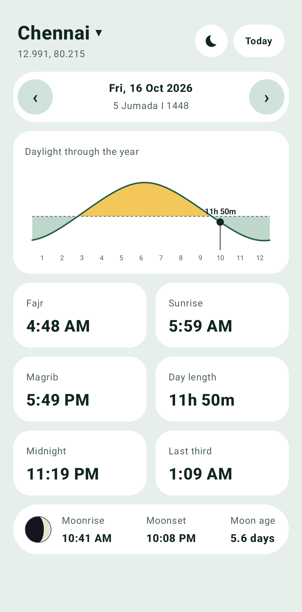
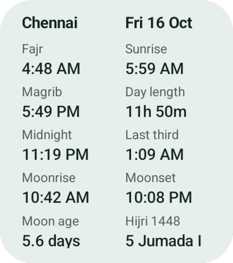
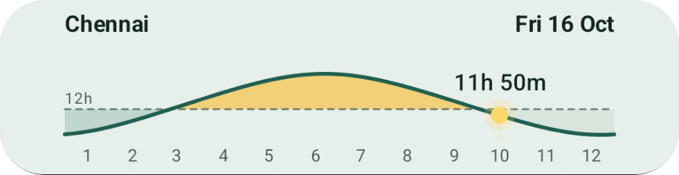

# Meeqat (ميقات)


Sun and moon times for Android, as an app and two home-screen widgets.
Everything is calculated on the phone, so it works offline and needs no internet

<table>
  <tr>
    <td align="center"><br><sub>App home screen</sub></td>
    <td align="center"><br><sub>Meeqat widget</sub></td>
    <td align="center"><br><sub>Daylight widget</sub></td>
  </tr>
</table>

## Features

**App**
- Fajr (true dawn), Civil Sunrise, Magrib (Civil Sunset), day length, midnight and the start of the last third of the night
- Moonrise, moonset and moon age, with a moon image drawn for the current phase
- Gregorian and Hijri date (Umm al-Qura). Move back and forward a day at a time, or jump to Today
- A year chart of day length
- Save several places and switch between them. Add or update your current location with one tap

**Widgets**
- **2x4:** the same times as the app, auto refreshes every midnight
- **4x1:** the daylight-through-the-year wave, with today marked and the current daylight hours above it

## Download

- Get the latest APK from the [Releases](https://github.com/anas005/meeqat/releases) page.
- Requires Android 8.0 (API 26) or newer and Google Play services (used to get your location).

## Build from source

You need Android Studio and JDK 17.

```
git clone https://github.com/anas005/meeqat.git
cd meeqat
./gradlew assembleDebug
```

The debug APK is written to `app/build/outputs/apk/debug/`.

## Accuracy and disclaimer

Times are calculated approximately: within a couple of minutes for the sun and a few minutes for the moon.
They have not been checked against every location and season. Hijri dates can differ by a day depending on the
calendar method and local moon sighting. For religious purposes, please confirm times with your local authority
or mosque.

## License

This project is licensed under the MIT License. See the [LICENSE](LICENSE) file for details.

